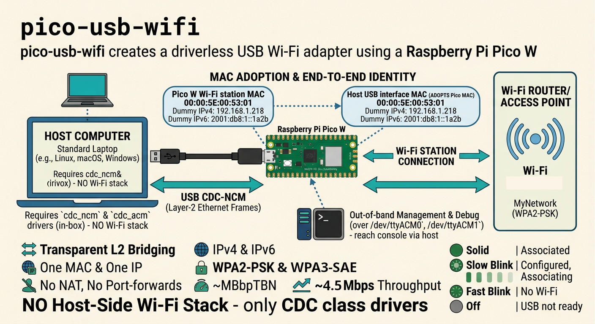
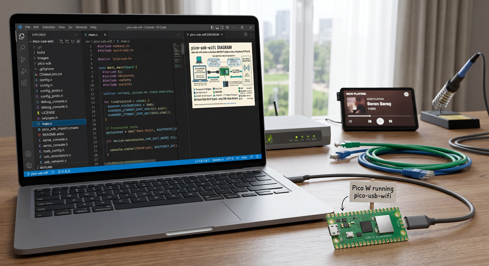
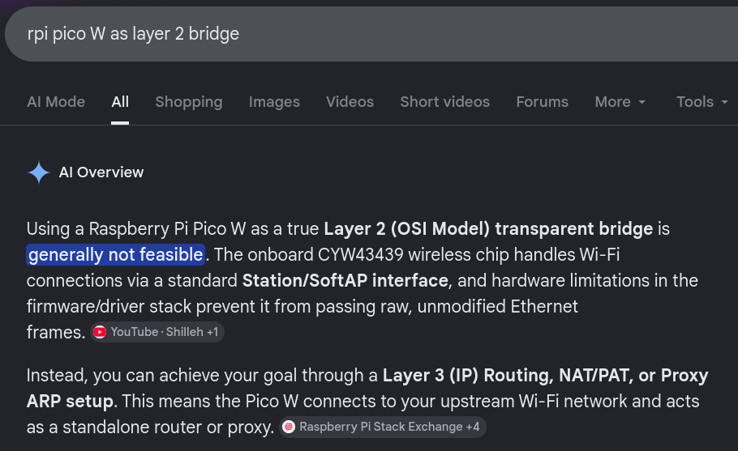
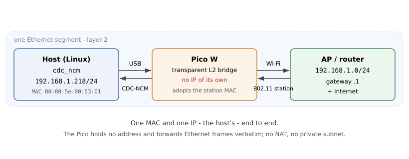

# README from https://gitlab.com/baiyibai/pico-usb-wifi
= pico-usb-wifi
:toc: macro
:toclevels: 3
:idprefix:
:idseparator: -

`pico-usb-wifi` is firmware for the Raspberry Pi Pico W that turns it into a driverless USB Wi-Fi adapter, enumerating as a USB CDC-NCM device.

:figure-caption: AI Slop

.pico-usb-wifi Diagram

The firmware works as a transparent layer-2 bridge that forwards frames between the Pico W's wireless interface and its USB interface.
The host's USB interface adopts the Pico W Wi-Fi station's MAC address, which provides a single MAC and IP identity end to end.

No host-side driver, kernel module, or wireless stack is required; see <<no-host-side-wi-fi-stack,No Host-Side Wi-Fi Stack>>.
The host only needs the in-box `cdc_ncm` and `cdc_acm` drivers that ship with every modern Linux, macOS, Windows, and mobile OS.

== Features

`pico-usb-wifi` provides these features:

* Transparent Layer-2 Bridging between the Pico W's wireless and USB interfaces
* USB CDC-NCM
* IPv4 and IPv6 with no NAT, no private subnet, and no port-forwarding to configure
* Out-of-band management and debug consoles over CDC-ACM serial; see <<management-console,Management Console>> and <<debug-console,Debug Console>>.
* WPA2-PSK and WPA3-SAE authentication (and open networks)
* Average 4.75 Mbits/sec throughput

.A Real World Situation

== Why This Exists

_I needed a USB Wi-Fi adapter to use in an upcoming embedded Linux project._
_I did not have a cheap USB Wi-Fi dongle, so instead of going and buying one from a brick-and-mortar store for five USD, I spent two days of a long holiday weekend and about one million Claude Code tokens building this firmware._

白一百, Author of pico-usb-wifi

Google said it was not feasible:

.pico-usb-wifi "Not Feasible"

toc::[]

== No Host-Side Wi-Fi Stack

Unlike a USB Wi-Fi dongle, this adapter exposes only an Ethernet-like interface to the host.
The Pico W contains the entire wireless side: the radio, the association, the WPA2/WPA3 supplicant, and the regulatory domain.

This allows systems to avoid installing `wpa_supplicant`, the `cfg80211`/`mac80211` wireless stack, a regulatory database, and chipset firmware or a vendor driver.
Provisioning the Wi-Fi credentials happens on the device, over its out-of-band management console, not through any host-side wireless tooling.
This keeps a constrained or appliance host or one without wireless drivers, or whose vendor kernel lacks them, the ability to connect to wireless networks using only  universal CDC class drivers.

== How It Works

[#fig-topology]
.Topology Diagram

The host's USB interface is given the Pico W's Wi-Fi station's MAC address, so a single MAC exists end to end and the Pico W can forward Ethernet frames verbatim between USB and Wi-Fi.
A Wi-Fi station cannot bridge several MAC addresses, so collapsing the host and the station onto one MAC is what makes a transparent bridge possible at all.
The full rationale, data path, and IPv6/multicast handling are described in <<architecture,Architecture>>.

== Host Requirements

The host requires the in-tree `cdc_ncm` and `cdc_acm` drivers.
Both have been part of mainline Linux for well over a decade, so any currently supported kernel includes them.
No out-of-tree module, firmware blob, or vendor driver is involved.
The same class drivers exist on macOS, Windows 10 and later, Android, and iOS.

[NOTE]
No other operating systems were tested.

== Building

The project is a standard pico-sdk CMake project.
It needs the ARM embedded toolchain, CMake, a build backend (Ninja or Make), Python 3, and a checkout of the pico-sdk with its submodules.
The TinyUSB and lwIP bundled in the pico-sdk are used unmodified.

=== Dependencies

On Arch-based systems (Arch, CachyOS, Manjaro), the toolchain comes from the official repositories:

[source,sh]
----
sudo pacman -S --needed \
  arm-none-eabi-gcc \
  arm-none-eabi-newlib \
  cmake \
  ninja \
  python \
  git \
  libusb
----

`arm-none-eabi-newlib` supplies the embedded C library and headers; without it the cross-compiler cannot find `stdint.h` and similar headers.
`libusb` is only needed for `picotool`, which the pico-sdk builds from source during the first configure to generate the UF2; no separate `picotool` package is required.

=== Build Steps

[#build-plain]
.Build With CMake And The pico-sdk
[source,sh]
----
git clone -b 2.2.0 --recurse-submodules https://github.com/raspberrypi/pico-sdk
export PICO_SDK_PATH="$PWD/pico-sdk"

cp src/wifi_config.h.example src/wifi_config.h   # then edit SSID/password, or leave blank
cmake -S . -B build -G Ninja -DPICO_BOARD=pico_w -DCMAKE_BUILD_TYPE=Release
cmake --build build
# -> build/pico-usb-wifi.uf2
----

The `-G Ninja` flag is optional; omit it to use the default Make generator (then `cmake --build build -j`).

`wifi_config.h` holds the compile-time default credentials and is gitignored.
Leaving it blank produces an image with no baked credentials that is provisioned at runtime over the management console (<<management-console,Management Console>>); filling it in bakes a default network.

== Writing the Firmware

The steps here load the firmware onto the board.

. Hold the BOOTSEL button while connecting the board over USB.
  It mounts as an `RPI-RP2` USB mass-storage volume, commonly under `/run/media/<user>/RPI-RP2` or `/media/<user>/RPI-RP2`.
. Copy `pico-usb-wifi.uf2` onto that volume.
  The board reboots into the firmware automatically.
. Connect the board to the host that is to receive Wi-Fi connectivity.

== Using On A Linux Host

Plug the device into the host and provision its Wi-Fi credentials once over the management console (<<management-console,Management Console>>).
The host's interface then behaves like any wired connection on the access point's network.

A host that manages interfaces automatically (NetworkManager, `systemd-networkd`, `dhcpcd`) needs no setup: it runs DHCP and SLAAC over the bridge and receives a single IPv4 address, an IPv6 address, the access point's gateway, and DNS, exactly as a wired client would.
There is no device-side address or gateway to configure, because the Pico holds none.
The interface's MAC address is the Wi-Fi station's MAC, which is how one identity is presented to the network.

The `ip` command output here shows the resulting interface: an ordinary DHCP/SLAAC client on the access point's own subnet, with the station's MAC and no trace of the Pico.

[#host-iface]
.The Host Interface After Association
[source,console]
----
$ ip addr show enp0s20f0u3u7
9: enp0s20f0u3u7: <BROADCAST,MULTICAST,UP,LOWER_UP> mtu 1500 qdisc fq_codel state UP
    link/ether 00:00:5e:00:53:01 brd ff:ff:ff:ff:ff:ff
    inet 192.168.1.218/24 brd 192.168.1.255 scope global dynamic enp0s20f0u3u7
    inet6 2001:db8:1::1a2b/64 scope global dynamic
    inet6 fe80::1/64 scope link
----

== Management Console

The management console is the configuration front end, on the first CDC-ACM serial function (commonly `/dev/ttyACM0`).
It is reachable as soon as the device enumerates, before Wi-Fi is associated, so provisioning never requires a network.

Open it with a serial terminal such as `picocom` or `screen`; the baud rate is irrelevant for USB CDC.
The console echoes input and shows a prompt, and every command prints the full device state.
Wi-Fi authentication is either WPA2-PSK or WPA3-SAE (AES).
The password is the network's passphrase or open when the password is left blank. 
A password-protected profile uses WPA2/WPA3 transition mode, so it joins either kind of access point.

The console stores up to eight credential _profiles_; one is the _active_ profile, and the device associates with it.
`set ssid`/`set pass` edit the active profile, `list`/`use`/`del` manage the set, and `scan` discovers nearby networks and joins one from a numbered list -- handy when an SSID has characters that are awkward to type.
Command words are case-insensitive; the console shows them in lower case.
The session here provisions a network by scanning for it.

[#config-session]
.Provisioning Over The Management Console
[source,sh]
----
$ picocom /dev/ttyACM0

-- pico-usb-wifi v1.1.0 --
    profiles:   0 saved (active: none)
    ssid:       (unset)
    pass:       unset
    country:    (unset)
    debug:      off
    status:     associating
    host IPv4:  (not seen yet)
(set|scan|list|use|save) # scan
[*] scanning...
    networks (3):
       1  MyNetwork             -47 dBm  a4:b1:c2:d3:e4:f5
       2  CoffeeShop            -68 dBm  00:11:22:33:44:55
       3  Neighbour             -81 dBm  9c:65:ee:ef:27:c7
(back|join|scan|live) # join 1
[*] staged -- set pass <password> then save
...
    profiles:   1 saved (active: 1)
    ssid:       MyNetwork
    pass:       unset
...
(set|scan|list|use|save) # set pass hunter2
[*] applying -- re-associating
...
(set|scan|list|use|save) # save
[*] saved to flash
...
----

A change takes effect immediately, re-associating with the active profile; a reboot is not required.
Repeat to save more networks; `list` shows them and `use <n>` switches the active one:

[#config-list]
.Managing Saved Profiles
[source,sh]
----
(set|scan|list|use|save) # list
    profiles (2/8):
      1* MyNetwork
      2  CoffeeShop  (open)
    (* = active)
(set|scan|list|use|save) # use 2
[*] applying -- re-associating
...
----

`save` persists every profile to flash; `restore` discards unsaved edits by reloading the saved record.
The table here lists the command set.

[#tbl-config-commands]
.Management-Console Commands
[cols="2,3", options="header"]
|===
|Command
|Effect

|`set ssid <text>`
|Set the active profile's SSID (a value may contain spaces) and re-associate; creates the first profile if none exists.

|`set pass <text>`
|Set the active profile's WPA2/WPA3 passphrase (blank for an open network) and re-associate.

|`set country <CC\|WORLDWIDE>`
|Set the regulatory country (fully applied on the next boot).

|`set debug <on\|off>`
|Stream diagnostics on the debug console; see <<debug-console,Debug Console>>.

|`list`
|List the saved profiles, marking the active one.

|`use <n>`
|Make profile _n_ active and re-associate.

|`del <n>`
|Delete profile _n_.

|`scan`
|Scan for nearby networks and enter the scan submenu (`back`, `join <n>`, `scan` to repeat, or `live` for a continuous disassociated stream). `join` stages the chosen network as the active profile, ready for `set pass`.

|`save`
|Persist all profiles and settings to flash.

|`restore`
|Discard unsaved changes by reloading the saved settings.
|===

The host's assigned address is shown in the state dump as `host IPv4` and `host IPv6`, snooped passively from the bridged traffic, since the Pico holds no address to report.

The configuration sector lives at the end of flash, separate from the program image at the start, so an ordinary `pico-usb-wifi.uf2` reflash leaves saved profiles intact (a full-chip erase clears them).
The exception is upgrading _to_ v1.1.0: the record layout changed to hold multiple profiles, so a pre-1.1.0 record is discarded and the networks must be re-entered once (see the changelog).

== Debug Console

The debug console is a write-only diagnostics stream on the second CDC-ACM serial function (commonly `/dev/ttyACM1`).
It is silent until `set debug on` is issued on the management console, so it has no cost when off and never interferes with management.

When enabled, it reports association changes and a periodic bridge-statistics line, as in the session here.
A `-DTRACE_FRAMES=1` build adds a one-line summary of each bridged frame, but it floods the console under load, so it is off by default.

[#debug-stream]
.A Debug-Console Session
[source,console]
----
$ picocom /dev/ttyACM1
associated to MyNetwork
stats: ->wifi=128 ->host=341 txdrop=0 rxdrop=0 refl=12 poolfail=0 ringpk=4 link=up hangs=0 faults=0 faultpc=0x00000000 freeram=152024 host=192.168.1.218
stats: ->wifi=143 ->host=372 txdrop=0 rxdrop=0 refl=14 poolfail=0 ringpk=3 link=up hangs=0 faults=0 faultpc=0x00000000 freeram=152024 host=192.168.1.218
----

The statistics fields are described in the table here.

[#tbl-debug-stats]
.Debug Statistics Fields
[cols="1,3", options="header"]
|===
|Field
|Meaning

|`->wifi`
|Frames forwarded from the host to Wi-Fi.

|`->host`
|Frames forwarded from Wi-Fi to the host.

|`txdrop`
|Host-to-Wi-Fi frames dropped because the station was not yet associated (the host retries).

|`rxdrop`
|Wi-Fi-to-host frames dropped because the USB side could not drain fast enough.

|`refl`
|Wi-Fi-to-host frames dropped because they were the host's own transmission, reflected by the access point.

|`poolfail`
|Host-to-Wi-Fi frames dropped because the lwIP pbuf pool was momentarily exhausted.

|`ringpk`
|Peak Wi-Fi-to-host USB-TX queue depth (out of 32) _since the previous stats line_, then reset -- a live gauge, where a value near 32 means USB cannot drain as fast as Wi-Fi delivers. (Unlike an all-time maximum, it falls again once a burst passes.)

|`link`
|Station Wi-Fi link status: `up` (associated), `join`/`down` (associating), or a failure reason -- `badauth` (wrong passphrase), `nonet` (SSID not found), `fail`.

|`hangs`
|Times the watchdog has recovered the firmware from a hang since the last cold power-on; see <<automatic-recovery,Automatic Recovery>>.

|`faults`
|Hard faults the firmware has recovered from since the last cold power-on.

|`faultpc`
|Address of the most recent hard fault (`0x00000000` if none), for mapping with `addr2line`.

|`freeram`
|Free RAM in bytes, for gauging headroom when tuning buffer sizes.
|===

Per-frame tracing shares the USB Full-Speed link with the bridged traffic, so it both reduces throughput and floods the console; it is a build-time option (`-DTRACE_FRAMES=1`) intended only for deep debugging.

== Automatic Recovery

A hardware watchdog reboots the device if the firmware ever stops servicing its main loop - a lockup or driver deadlock - so it re-enumerates on its own within a few seconds instead of needing to be unplugged.
A separate hard-fault handler catches a CPU fault immediately and records the faulting address.

The bridge counters from just before the crash survive the reboot in uninitialised RAM.
On recovery the device prints a one-line `RECOVERED from ...` report on the debug console with those counters (and the faulting address for a hard fault), and the running `stats:` line carries `hangs`, `faults`, and `faultpc` tallies, so a crash leaves a diagnostic trace even though it cleared itself.

== Onboard LED States

The table here lists the onboard LED patterns and their meaning.

[#tbl-led]
.Onboard LED Patterns
[cols="1,3", options="header"]
|===
|Pattern
|Meaning

|Solid
|Associated with an access point - the normal running state.

|Slow blink - 1 Hz
|Wi-Fi configured, associating or not yet associated.

|Fast blink - 5 Hz
|No Wi-Fi configured; provision it over the management console.

|Double flash - two quick pulses, then a pause
|Live (continuous) scan running; the device is disassociated and streaming nearby access points to the management console until a key is pressed.

|Off
|USB not ready.
|===

== Future Work

The bridge runs over the RP2040's native Full-Speed USB (12 Mbit/s), so throughput tops out around 4-5 Mbit/s of TCP payload - ample for a dashboard or control surface, but a hard ceiling.
The bottleneck is the USB link, not the Wi-Fi radio.
Some directions that could raise it, in rough order of effort:

* *Second core.* The RP2040's second core is idle. Moving the Wi-Fi-to-host drain, or the USB service, onto core 1 could relieve the single-core main loop and lift the sustained rate.
* *PIO experiments.* https://github.com/steve-m/Pico-100BASE-TX[Pico-100BASE-TX] bit-bangs 100BASE-TX Ethernet straight from the RP2040's PIO at roughly 100 Mbit/s; whether similar PIO techniques could drive the USB side faster here is an open question.
* *Custom hardware.* A custom PCB pairing the Pico W with a dedicated High-Speed USB PHY would lift the USB-side ceiling well past Full Speed.
* *802.11 monitor mode / Monitor mode* As a layer 2 bridge, the pico-us-wifi does not support these modes. The Infineon CYW43439 firmware has a monitor capability, and others have experimented with raw frame capture on the part, but that likely requires writing firmware and an accompanying drive which exposes the Pico W's Wi-Fi MAC directly to the host OS, and additional work in the pico-sdk project.

None of these are required for the firmware's intended use; they are starting points for anyone wanting more throughput.

== Upstream Libraries And Credits

This firmware is assembled from several upstream projects, recorded in the table here.

[#tbl-upstream]
.Upstream Components
[cols="1,2,1,4", options="header"]
|===
|Component (in-tree files)
|Upstream
|Licence
|Role

|USBNet
|https://github.com/mattmyne/usbnet[mattmyne/usbnet]
|MIT
a|Base USB-network module, USB descriptors, and the main skeleton, extended here into the Wi-Fi bridge.

* `usb_network.c`, `usb_network.h` - rewritten as the L2 bridge
* `usb_descriptors.c` - modified to include composite CDC-NCM + dual CDC-ACM
* `tusb_config.h` - modified

|TinyUSB
|https://github.com/hathach/tinyusb[hathach/tinyusb]
|MIT
a|USB CDC-NCM and CDC-ACM device stack, used as bundled in the pico-sdk. +

* No in-tree files
* Bundled in the pico-sdk
* Used unmodified

|pico-sdk 2.2.0
|https://github.com/raspberrypi/pico-sdk[raspberrypi/pico-sdk]
|BSD-3-Clause
a|Board support, build system, and the bundled TinyUSB, lwIP, and cyw43-driver.

* `pico_sdk_import.cmake` - exact copy
* `lwipopts.h` - trimmed  pico_w example
* bundled TinyUSB, lwIP, cyw43-driver - unmodified

|TinyUSB `net_lwip_webserver` example 
|Peter Lawrence and Ha Thach, via https://github.com/hathach/tinyusb[hathach/tinyusb]
|MIT
a|Original basis of the USB-network glue; reduced to the CDC-NCM path. +

* No separate in-tree files
* Original basis of the USBNet files

|lrndis
|https://github.com/fetisov/lrndis[fetisov/lrndis]
|MIT
a|Design influence on the USB-network approach +

* Not vendored
|===

The remaining sources are original to this project:

* `main.c`
* `config.c`
* `config.h`
* `config_proto.c`
* `config_proto.h`
* `serial_console.c`
* `serial_console.h`
* `wifi_scan.c`
* `wifi_scan.h`
* `debug_console.c`
* `debug_console.h`

== Licence

This project is MIT licensed; see link:LICENSE[LICENSE].
Upstream components retain their own licences as recorded in <<upstream-libraries-and-credits,Upstream Libraries And Credits>>.

== Architecture

=== Overview

The device is a USB CDC-NCM peripheral that bridges a host to Wi-Fi.
The Pico W runs the Wi-Fi station and shuttles Ethernet frames between the USB link and the radio.
The host runs its own IP stack and holds the single network identity; the Pico holds no IP of its own.
The host needs nothing beyond the in-box `cdc_ncm` and `cdc_acm` drivers.

=== Why A Layer-2 Bridge Via MAC Adoption

The goal is for the host to appear on the Wi-Fi network as an ordinary device with one address, while the Pico stays invisible.
One hard physical-layer constraint shapes how that is achieved.

A Wi-Fi station cannot transparently bridge multiple MAC addresses.
When the Infineon CYW43 associates to an access point in station mode, the association grants exactly one MAC address, and the 802.11 data frames it sends are bound to that station MAC.
Without four-address (WDS) frames, which the access point must also support and permit, the radio cannot carry frames on behalf of other MAC addresses behind it.
This is the well-known limitation that a Wi-Fi client cannot be bridged.

This firmware does not fight that constraint; it removes it.
The host's USB interface is told to adopt the Wi-Fi station's MAC address, so there is exactly one MAC end to end.
With host and station sharing one identity, the Pico is a dumb layer-2 bridge: it forwards Ethernet frames verbatim between USB and Wi-Fi, touching nothing above layer 2.
The access point sees a single, ordinary station; the host runs DHCP, SLAAC, and Neighbor Discovery itself and holds the resulting addresses.

The consequences are listed in the table here.

[#tbl-bridge-effects]
.Properties Of The MAC-Adoption Bridge
[cols="1,3", options="header"]
|===
|Property
|Why it holds

|One IP, held by the host
|The Pico assigns itself no address, so there is a single identity, on the access point's own subnet - not a private tether subnet.

|IPv4 and IPv6 alike
|Forwarding is at layer 2, so SLAAC, DHCPv6, router advertisements, and Neighbor Discovery pass through unchanged, with no version-specific code.

|No NAT and no port-forwards
|Nothing is rewritten, so inbound connections reach the host directly; there is nothing to masquerade or map.

|No host-side Wi-Fi stack
|The Pico owns the association and supplicant, so the host needs no `wpa_supplicant`, regulatory database, or wireless driver - only the CDC class drivers.
|===

=== Data Path

On the USB side, TinyUSB provides the CDC-NCM device, and the host's interface MAC is set to the station MAC at start-up (`usb_network_set_host_mac`, before enumeration).

Host-to-Wi-Fi: a frame arrives via `tud_network_recv_cb`, is staged, and in the main loop is transmitted onto the radio with `cyw43_send_ethernet`.

Wi-Fi-to-host: the station netif's `input` handler is replaced, so every frame the cyw43 driver receives is handed to the bridge instead of lwIP, queued, and transmitted to the host with `tud_network_xmit`.

No lwIP IP interface exists on the USB side, and the station netif carries no IP; lwIP serves only the cyw43 netif's link state and the pbuf pool.

=== Concurrency Model

The firmware uses `pico_cyw43_arch_lwip_threadsafe_background`.
Wi-Fi is serviced in a background IRQ and async context so that it never starves USB, whose `tud_task()` runs in the main loop.
This arrangement has one strict consequence for the bridge.

TinyUSB must be touched only from the main loop, yet Wi-Fi frames are received in the background context.
The Wi-Fi receive handler therefore only enqueues each frame into a ring buffer, and the main loop drains that ring into `tud_network_xmit`.
Violating this rule manifested host-side as `NETDEV WATCHDOG: transmit queue timed out`, with USB dropping out.
Sending host frames onto Wi-Fi happens in the main loop and holds `cyw43_arch_lwip_begin()`/`cyw43_arch_lwip_end()` around the cyw43 call.

=== Multicast And IPv6

A station, by default, receives only the multicast groups it has joined.
The bridge runs no IP stack of its own and joins nothing, so without intervention the radio would drop the multicast that IPv6 depends on, and the host's IPv6 would not work through the bridge.
Router advertisements, duplicate-address detection, and address resolution all ride on multicast.

On each association the firmware sets the CYW43 `allmulti` iovar, so the station delivers all multicast frames regardless of the filter.
This is done with the public `cyw43_ioctl` against `WLC_SET_VAR`, not by entering monitor mode, so the Ethernet frame format is unchanged.
A network behind an IGMP- or MLD-snooping switch may still prune some multicast that the host never solicited; a flat home access point floods it.

=== Self-Reflection Filter

Because the host shares the station MAC, a multicast or broadcast the host sends is flooded by the access point back to the station, which now receives all multicast, and would be handed back to the host as its own frame.
The receive handler drops any Wi-Fi-to-host frame whose source MAC is the station MAC, since that frame can only be the host's own transmission reflected by the access point.
A bridge must not echo a station's frames back to it; the drop is counted as `refl` in the debug statistics.

=== The Two Serial Consoles

Management and diagnostics are out of band, on two CDC-ACM functions of the same composite USB device, rather than on the network.
This is a deliberate consequence of transparency: the network side carries only the host's traffic and has no address for the Pico to answer on.

The management console (`/dev/ttyACM0`) runs the configuration line protocol and is reachable the instant USB enumerates, before Wi-Fi is up, so the device is always provisionable without any IP.
The debug console (`/dev/ttyACM1`) is a write-only diagnostics stream - association events, periodic bridge counters, and optional per-frame packet summaries - emitted only when enabled, so it costs nothing when off and never clutters the management console.
Neither console touches the network, so neither generates traffic that a host firewall logs.

=== Configuration Storage

The runtime settings - up to eight Wi-Fi credential profiles, the active-profile index, regulatory country, and the debug flag - live in a single record in the last flash sector, clear of the program image at the start of flash.
The record spans several flash pages, so a `save` programs the whole sector at once (the erase is sector-wide regardless).
At boot the record is accepted only on an exact match of its magic number and a CRC-32 over the rest of the struct; any mismatch loads the compile-time defaults instead.
There is no versioned migration: a change to the record layout simply fails the magic/CRC check and falls back to defaults, which is acceptable because a baked compile-time default still seeds the first profile. (This is why upgrading to v1.1.0, which widened the record to a profile list, discards a pre-1.1.0 record.)

A `save` writes the record back through `flash_safe_execute`, which coordinates the erase and program against the other core and disables interrupts for the few milliseconds it takes.
That write runs from the console handler while the lwIP lock is held; the brief interrupt-disabled window pauses background Wi-Fi servicing, which is acceptable for an infrequent, host-initiated save.

=== Hardware And Toolchain Quirks

These behaviours of the RP2040, the Infineon CYW43, and the pico-sdk cost real debugging time and are easy to reintroduce.

==== Background Servicing Requires Main-Loop-Only TinyUSB

This is the concurrency rule stated in <<concurrency-model,Concurrency Model>>.
With background servicing, Wi-Fi receive runs in a context that may not call TinyUSB, which is why the deferred transmit ring exists.

==== Association Is Not An IP

The cyw43 helper `cyw43_tcpip_link_status` reports `CYW43_LINK_UP` only once the station holds an IP address, and this station deliberately never takes one.
The associated state is therefore read from the netif link flag (`netif_is_link_up`), which the bridge also uses to decide whether to forward.

==== A Changed Identity Needs A New Product ID

A composite device that changes its interface set while keeping the same USB vendor and product id can be served a cached descriptor by the host.
The product id is derived from the enabled classes, so adding each CDC-ACM function shifts it (`cafe:4020` to `cafe:4022`) and the host re-reads the new layout.

==== Release Builds Make `assert` A No-Op

A `CMAKE_BUILD_TYPE=Release` defines `NDEBUG`, which compiles `assert()` to nothing, so an allocation guarded only by an assertion sails past a failure and dereferences NULL.
A firmware crash before `tud_task` runs appears host-side as USB enumeration error `-110`, a device-descriptor read timeout.
Real NULL guards are used rather than assertions on the start-up path.

=== Verified Environment

The configuration confirmed to work uses pico-sdk 2.2.0, the `arm-none-eabi` GCC toolchain, and the TinyUSB and lwIP bundled in the pico-sdk, unmodified.
The reference board is the Pico W (RP2040).
The Pico 2 W (RP2350) is expected to work.
A build produces a `build/pico-usb-wifi.uf2` of roughly 670 KB.
